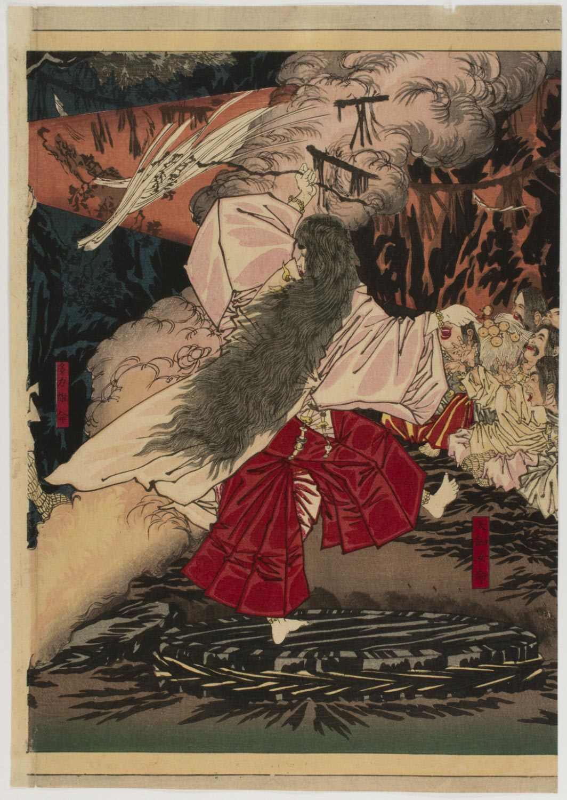

<p align="center">
  
</p>

<h1 align="center">Uzume</h1>

<p align="center">
  <strong>An independent, understandable and opinionated Neovim distribution</strong><br>
  for reading code, reviewing agent changes, and programming by hand.
</p>

<p align="center">
  <a href="#development-approach"></a>
  <a href="editor/README.md#installation-and-pins"></a>
  <a href="docs/features/installation.md#verification-and-remaining-work"></a>
</p>

<p align="center">
  <a href="editor/README.md#installation-and-pins"><strong>Install</strong></a> ·
  <a href="docs/features/README.md">Features</a> ·
  <a href="#shortcuts">Shortcuts</a> ·
  <a href="editor/EXTRAS.md">Extras</a> ·
  <a href="docs/design.md">Design</a>
</p>

<p align="center">
  <a href="https://commons.wikimedia.org/wiki/File:Uzume_dancing.jpg">
    
  </a>
</p>

<p align="center">
  <em>“We are rejoicing, laughing, and enjoying ourselves because there is a deity more noble than you.”</em><br>
  — Ame-no-Uzume, adapted from the <a href="https://sacred-texts.com/book/the-kojiki-2/section-xvi-the-door-of-the-heavenly-rock-dwelling"><em>Kojiki</em>, Section XVI</a>
</p>

<p align="center">
  <sub>Artwork: Tsukioka Yoshitoshi, 1879 · <a href="https://commons.wikimedia.org/wiki/File:Uzume_dancing.jpg">Wikimedia Commons</a> · <a href="https://creativecommons.org/licenses/by-sa/4.0/">CC BY-SA 4.0</a> · reproduced unchanged</sub>
</p>

---

## Why Uzume?

Uzume takes its name from **Ame-no-Uzume**, the Japanese goddess whose dance helped draw the sun goddess Amaterasu out of her cave. Her story connects creativity, laughter, and the return of light—an inspiration for a personal editor that helps bring clarity to complex work. See [Kokugakuin University's Encyclopedia of Shinto](https://d-museum.kokugakuin.ac.jp/eos/detail/?id=9422) for the myth behind the name.

## Install

With Neovim 0.11+, Python 3.12+, Git, ripgrep, fd and a C compiler installed:

```sh
git clone https://github.com/Memnoc/uzume.git ~/Code/uzume
cd ~/Code/uzume
python3 setup-editor --register
~/.local/bin/uzume
```

No existing Neovim config or caches are needed. See the
[installation guide](docs/features/installation.md) for platform status, language
tools and adding the launcher to PATH.

Run `uzume path/to/file` to open a file directly. Plain `nvim` keeps your existing
configuration. Upgrading an older preview? Follow the
[namespace migration guide](docs/features/namespace-migration.md).

## Shortcuts

**Space** is the leader key. Press it and pause to browse the menus, or press
**Space ?** to search mappings by typing a description or key combination.
The home screen also offers **k · Search Keymaps**.

| Shortcut | Action |
| --- | --- |
| **Space ?** / **Space sk** | Search all active key mappings |
| **Space s?** | Show current-buffer shortcut help |
| **Space e** | Toggle the project file explorer |
| **Space Space** | Find project files |
| **Space /** | Search project text |
| **Space ,** | Switch buffers |
| **Ctrl-s** | Save the current file |
| **Space l** | Open Extras and language tools |
| **Space ap** | Pick or open a project |
| **Space ww** / **Space wn** | Pick a window / create an editor window |
| **Space ps** / **Space pv** | Split the editor down / right |
| **Ctrl-h/j/k/l** | Focus the pane to the left / down / up / right |
| **Space pf** / **Space pm** | Float or dock a pane / fullscreen or restore it |
| **Space ac** / **Space aC** | Start a Codex / Claude task on a named branch |
| **Space aa** | Find agents needing attention |
| **Space vr** | Review task changes |
| **Space vc** / **Space vs** | Comment on review lines / preview comments to send |
| **Space vi** | Integrate a task into a local branch or continue integration |
| **Space gs** | Inspect Git status |
| **Space uh** | Toggle inlay hints |
| **Space uA** | Choose pane animations or Instant |
| **Space qq** | Quit with unsaved-change confirmation |

Keymap search is a floating shortcut guide: type to filter, use **Ctrl-n/p** or
arrow keys to browse, and **Esc** or **Enter** to return. It lists live global
and current-buffer mappings across modes, including those added by plugins and
language servers. **Ctrl-b** toggles buffer mappings; **Ctrl-g** toggles global
mappings. Search examples: `split`, `review`, `inlay`, `Space ac`.

See the [editor walkthrough](editor/README.md#first-walkthrough) for a first tour,
[Extras](editor/EXTRAS.md) for language packs, and the
[AI task guide](docs/features/agents.md) for the agent → review → integration flow.

## Documentation

- [Lua module map](editor/lua/README.md): code grouped by editor feature.
- [Maintainer handoff](docs/HANDOFF.md): architecture, verification, decisions, and prioritized next work.
- [Design record](docs/design.md): agreed behavior, deferred features, and open questions.
- [Feature guide](docs/features/README.md): available features, shortcuts, implementation and limits.
- [Domain glossary](CONTEXT.md): the meaning of projects, windows, panes, tasks, and reviews.
- [Architecture decisions](docs/adr/README.md): choices and their tradeoffs.
- [First prototype](docs/prototypes/0001-native-sessions.md): scope, technical findings, and pending hands-on evaluation.

## Development approach

Every feature change includes an updated feature write-up: behavior, controls,
implementation, dependencies and stored state, verification, and known limits.
Keep the feature index current and distinguish implemented features from plans.

Development proceeds in small, testable increments. Record design decisions, use focused prototypes to resolve uncertainty, and validate real editing workflows before expanding the feature set.

The initial reference terminals are Ghostty and WezTerm on macOS and Linux. Kitty is an additional compatibility target. Pane motion uses native terminal cells; visual performance still needs evaluation under busy agent output.

The Uzume name and cave-and-sun logo are established. Rust component boundaries and the production dependency set remain open.

## Repository layout

- `editor/`: the active distribution, including Lua UI and Python process/Git helpers.
- `installer/` and `setup-editor`: source installation and launcher registration.
- `tests/`: regression tests; `docs/`: features, architecture decisions and handoff.
- `spikes/` and `spike`: historical experiments, never loaded by the installed editor.

`editor/lua/uzume/editor/` contains the editor's core modules. Agent, review,
integration and layout modules live beside it under `uzume/`. See the
[Lua map](editor/lua/README.md). Compatibility links may remain at old storage
paths after migration so existing worktrees and saved records keep working.
